# AVA Phoenix

[](https://github.com/Harlock123/AVAPhoenix/actions/workflows/build.yml)

A bird-blasting shooter in the style of the 1980 arcade game **Phoenix**, built with .NET 10 and Avalonia
UI. Shoot down two waves of small birds, then two of great fire-birds whose wings grow back as fast as
you can shoot them off. Then bore through the hull of the mothership to reach the Warden at its heart.
When things get too hot, raise your shield, but it holds the ship still while it's up.

## Features

- **The ship**:
  - **Flying and firing:** it slides left and right along the bottom and fires up to two shots at once. Hold the button to keep firing.
  - **The shield:** it stops bullets and destroys any bird that flies into it. While it's up, the ship can't move. It lasts a moment, then takes a while to recharge, and the panel on the left shows how long.
- **The waves**, five to a cycle:
  - **Flitters (waves 1 and 2):** small birds flutter in formation as it drifts from side to side, then peel off one by one. They weave down at the ship, firing as they come, and loop round from the top back to their places. The second wave is fiercer.
  - **Emberwings (waves 3 and 4):** they hatch from glowing eggs and wheel about their places, coming slowly lower, and dive at the ship now and then.
    - **Their wings:** each wing is made of four segments. A shot through a wing cuts it back from that point, but it grows back.
    - **Bringing one down:** only a shot to the body kills it.
  - **The mothership (wave 5):** a great saucer drifts slowly down and from side to side. Flitters guard it from below, and it rains bullets from its underside. The Warden sits under a dome at its heart.
    - **Getting through:** shoot a hole through the thick hull, then through the turning band above it, which keeps bringing fresh cells over the hole.
    - **The Warden:** fire up through the narrow window to reach it.
  - **Going round again:** after the mothership the cycle starts again, faster, with more bullets in the air.
- **Scoring**:
  - Flitters 20 or 40 in their places, 80 diving
  - Emberwings 100 or 150 in their places, 400 or 600 diving, and 10 for each piece of wing
  - The Warden 9,000 if it's brought down quickly, 1,000 less for every 10 seconds taken, but never less than 2,000
  - An extra ship at 20,000 and every 60,000 after that
- **Sound**:
  - **The title tune:** the opening of Beethoven's *Für Elise* (public domain), the tune the original machine played, here on a music-box voice.
  - **The effects:** the gun, the dives' falling whistle, Flitters popping and Emberwings squawking, wing feathers, the hull and band being chipped, the shield's hum, the mothership's throb and its last explosion, plus new jingles.
  - All of it is synthesised and mixed by OpenAL.
- **Attract mode**: leave the title alone for 15 seconds and a computer pilot plays.
  - It looks a moment ahead for bullets and diving birds and slips aside from them, raising the shield when there's nowhere to go.
  - Otherwise it lines up under the best target, allowing for where it will be when the shot gets there, and holds the trigger down.
  - On the mothership, it bores a hole under the Warden and follows it as the mothership drifts.
- **A top-ten high-score table** with arcade-style initials entry. It records the wave reached.
- **Gamepads** through SDL2, as well as the keyboard.
- **Any window size**: the screen scales to fit, letterboxed. **Ctrl+S** saves a screenshot.
- **One self-contained executable** per platform: Windows, macOS and Linux on Intel/AMD and ARM.

## Screenshots

| The title | Wave 1 | Flitters diving |
|:---------:|:------:|:---------------:|
| 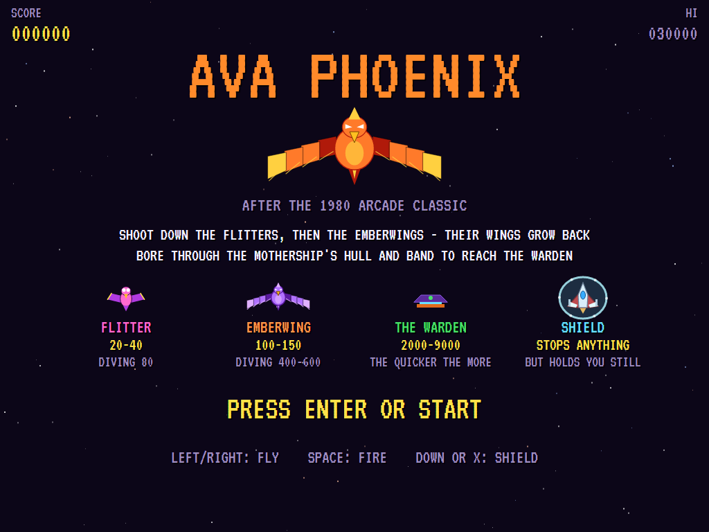 | 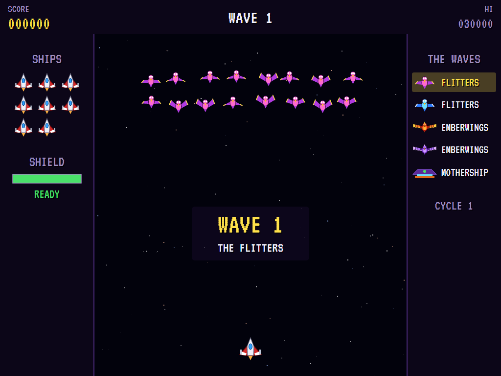 | 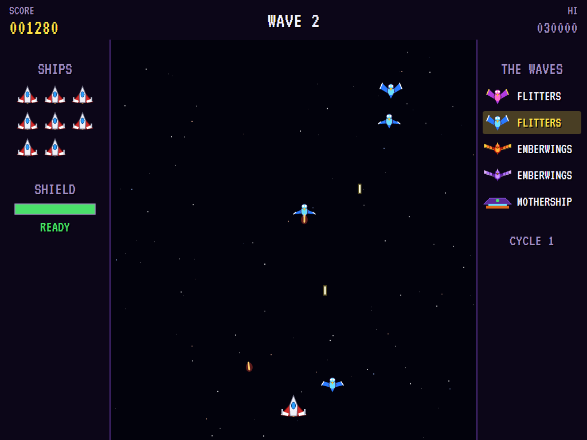 |
| What everything is worth. | The formation. | They weave down, firing. |

| Hatching | Emberwings | Diving |
|:--------:|:----------:|:------:|
| 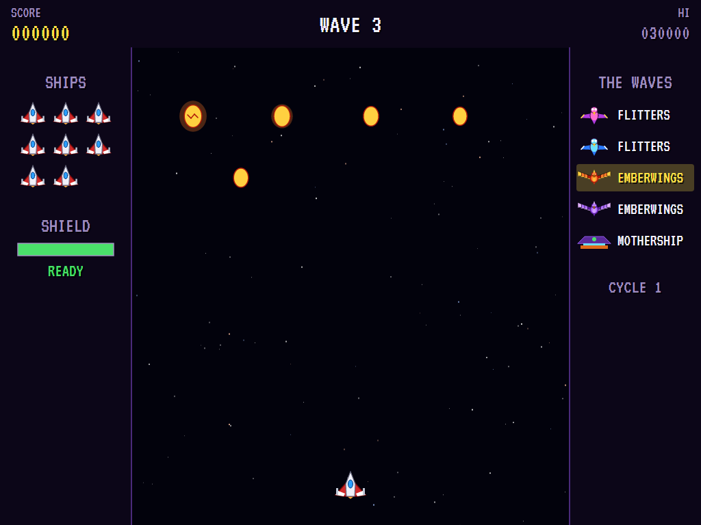 | 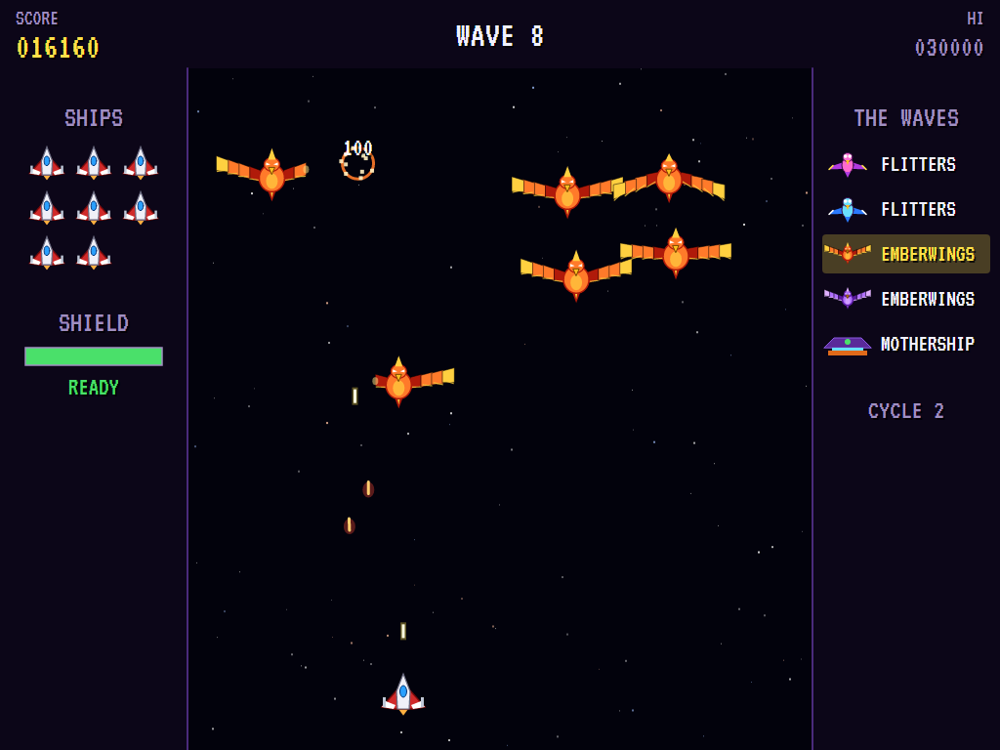 | 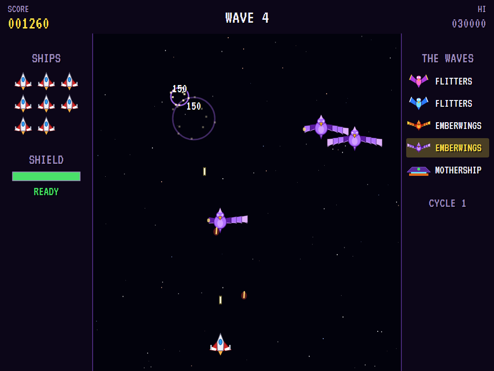 |
| The eggs crack. | Shot wings grow back. | The fiercer ones. |

| The shield | The mothership | The Warden falls |
|:----------:|:--------------:|:----------------:|
| 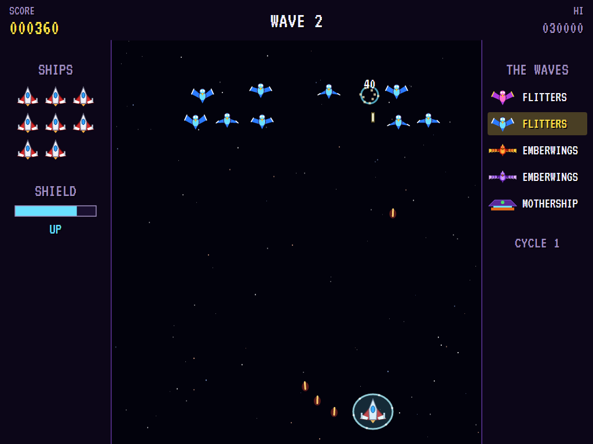 | 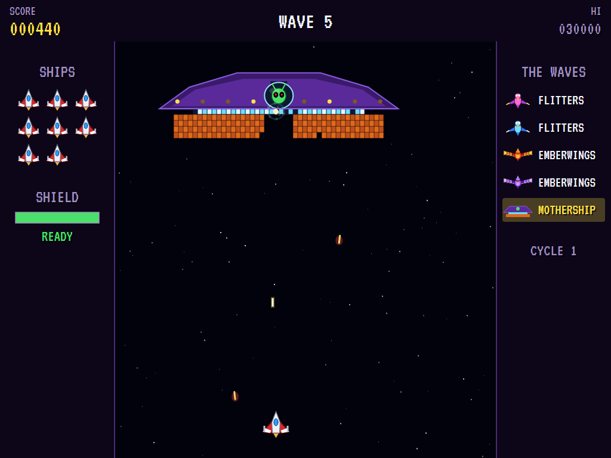 | 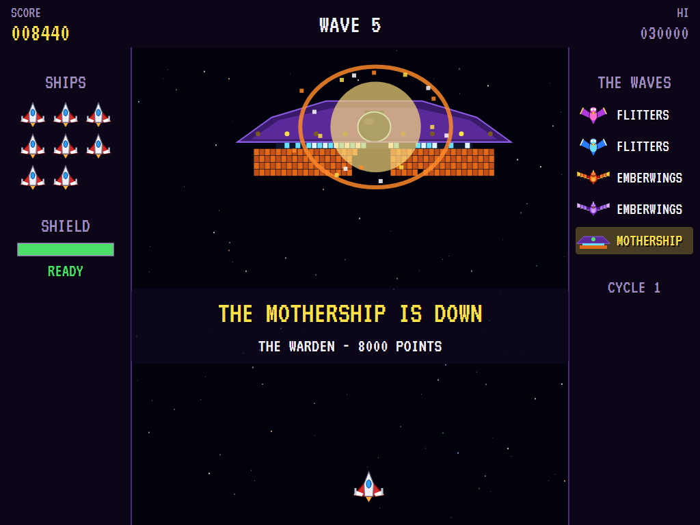 |
| Nothing gets through. | A hole through the hull. | Down it goes. |

| Shot down | The aces | |
|:---------:|:--------:|:-:|
| 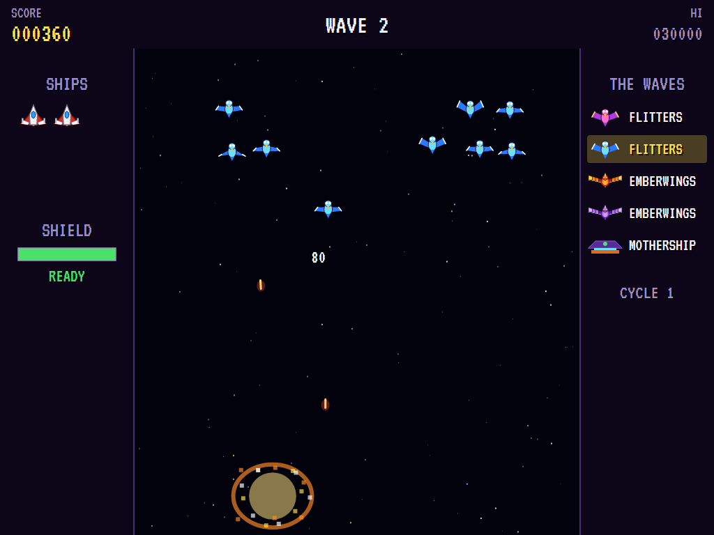 | 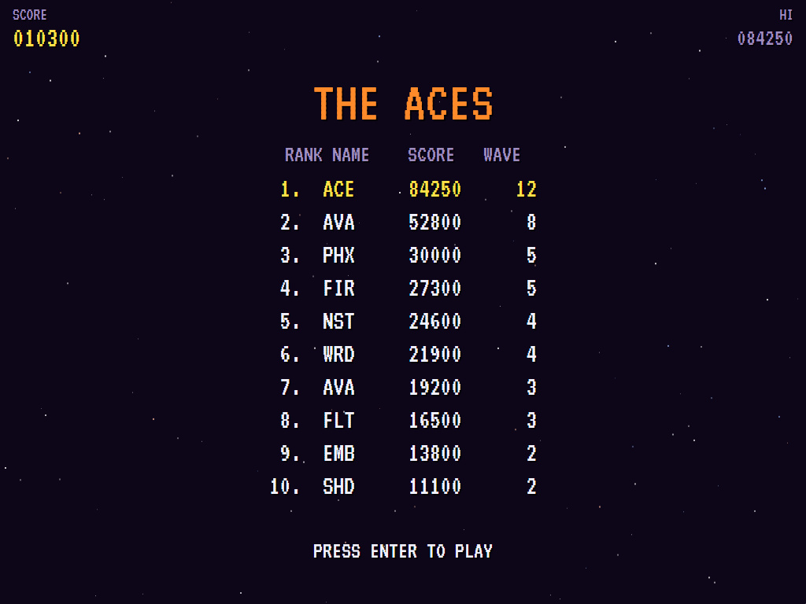 | |
| One bullet too many. | The high-score table. | |

The screenshots are made by the tests, which play the game in a real (headless) window; see
[Tests](#tests).

## Download and run

Ready-to-run builds for Windows, macOS and Linux, on both Intel/AMD and ARM, are on the
[Releases page](https://github.com/Harlock123/AVAPhoenix/releases/tag/latest). **Latest build** is rebuilt
on every push to `main`. Each download is one self-contained executable: no .NET install is needed.

| Platform | Archive |
|---|---|
| Windows | `AVAPhoenix-win-x64.zip`, `AVAPhoenix-win-x86.zip`, `AVAPhoenix-win-arm64.zip` |
| macOS | `AVAPhoenix-osx-arm64.tar.gz` (Apple silicon), `AVAPhoenix-osx-x64.tar.gz` (Intel) |
| Linux | `AVAPhoenix-linux-x64.tar.gz`, `AVAPhoenix-linux-arm64.tar.gz`, `AVAPhoenix-linux-arm.tar.gz` |

```bash
tar -xzf AVAPhoenix-linux-x64.tar.gz     # or linux-arm64, linux-arm, osx-arm64, osx-x64
./AVAPhoenix
```

On Windows, unzip and run `AVAPhoenix.exe`. On macOS, if Gatekeeper refuses to open it, run
`xattr -d com.apple.quarantine AVAPhoenix` once. Run with `--no-audio` for silence.

**Sound** comes through OpenAL Soft, built in for every platform. In a virtual machine the game
detects it and uses a larger audio buffer, so the sound doesn't break up.

**Gamepads** use SDL2, which is bundled for Windows, macOS and Intel/AMD Linux. ARM Linux builds need it
installed; without it the keyboard still works:

```bash
sudo apt install libsdl2-dev            # Debian / Ubuntu / Raspberry Pi OS
sudo pacman -S --needed sdl2-compat     # Arch / Omarchy
```

## Controls

| Input | Action |
|-------|--------|
| **Enter** | Start |
| **Left** / **Right** (or **A** / **D**, or the numeric keypad) | Fly |
| **Space** / **Z** / **Ctrl** | Fire (hold to keep firing) |
| **Down** / **X** / **S** / **Shift** | Raise the shield |
| **P** / **Esc** | Pause (Esc again to quit) |
| **M** | Mute |
| **Ctrl+S** / **Cmd+S** | Save a screenshot to the Pictures folder |

**Gamepad**: left stick or D-pad to fly, **A** or **X** to fire, **B** or **Y** (or down) for the shield,
**Start** to start and pause, **Back** (while paused) to quit.

**Entering initials**: type letters, or dial with **Up**/**Down** and accept with **Space**; **Left** /
**Backspace** go back; **Enter** finishes.

## Tests

```bash
dotnet test AVAPhoenix.slnx
```

The engine has no UI and runs in fixed 60 Hz steps, so it plays the same at any frame rate, and a seed
always plays the same game. The tests check:

- **The waves:** Flitters, Emberwings and the mothership in order, then round again faster
- **The ship:**
  - flying to the edges and no further
  - two shots at a time, and holding the button to keep firing
- **The birds:**
  - Flitters' points in their places and diving
  - Emberwings' wings cut back by shots and growing again, and only the body killing one
  - their eggs, which shots pass through
  - swooping and firing, and coming round from the top back to their places
- **The shield:** holding the ship still, stopping bullets, destroying birds, and having to recharge
- **Losing ships:** to bullets and to birds, the next in the middle, and the last ending the game
- **The mothership:**
  - the hull chipped from below, then the band (which turns), and the shell stopping the rest
  - the Warden brought down through the hole, and worth more the quicker
- **The machine:** a wave cleared and the next coming, extra ships, the computer pilot clearing the first waves, the attract cycle, the same game from the same seed, initials and the high-score file

The screenshot tests draw the real screen in a headless window. To refresh the README's pictures:

```bash
PHOENIX_SHOTS=$PWD/Images dotnet test tests/AVAPhoenix.Tests --filter ScreenshotTests
```

To see how the computer pilot gets on, wave by wave (for tuning), or how a player who just sits in the
middle and fires does (`PHOENIX_PROBE=lazy`):

```bash
PHOENIX_PROBE=1 dotnet test tests/AVAPhoenix.Tests --filter PilotProbe --logger "console;verbosity=detailed"
```

## Building

```bash
dotnet build AVAPhoenix.slnx
dotnet run --project src/AVAPhoenix
```

Needs the .NET 10 SDK. The sounds are made by `tools/make_sounds.py` (standard-library Python):
`python3 tools/make_sounds.py` rewrites `src/AVAPhoenix/Sounds`.

## Project structure

```
AVAPhoenix/
├── AVAPhoenix.slnx
├── src/AVAPhoenix/
│   ├── Engine/
│   │   ├── GameEngine.cs        # States, the title and demo cycle, and the mothership's throb
│   │   ├── GameEngine.Play.cs   # The ship and its shield, shots, the waves, Flitters and Emberwings,
│   │   │                        # swoops and bullets, the mothership and the Warden, and scoring
│   │   ├── ShipPilot.cs         # The computer pilot, for the demonstration (and the tests)
│   │   ├── Entities.cs          # The field, the ship, birds and their wings, the mothership's parts
│   │   ├── HighScoreTable.cs, InitialsEntry.cs
│   │   ├── InputHandler.cs, ControllerManager.cs  # Keys and an SDL2 gamepad
│   │   └── SoundManager.cs      # Effects and the tunes through OpenAL
│   ├── Audio/                   # The OpenAL engine (from the author's AVABand)
│   ├── Views/                   # The starfield, the ship, the birds, the mothership, the panels, the screens
│   └── Sounds/                  # The synthesised effects and tunes
├── tests/AVAPhoenix.Tests/      # Gameplay, screenshot and probe tests
├── tools/make_sounds.py
└── Images/                      # Screenshots
```

## About and licence

AVA Phoenix © 2026 Lonnie Watson, under the [MIT License](LICENSE).

*Phoenix* © 1980 Amstar Electronics; the name belongs to its current owner. AVA Phoenix is an independent,
unofficial game in its style. Its ship, its Flitters and Emberwings, its mothership and the Warden, its
graphics, sounds, jingles and code are its own; nothing is taken from the arcade machine's program,
graphics, sound or music. *Für Elise* (Beethoven) is in the public domain. It is not affiliated with or
endorsed by any rights holder.
